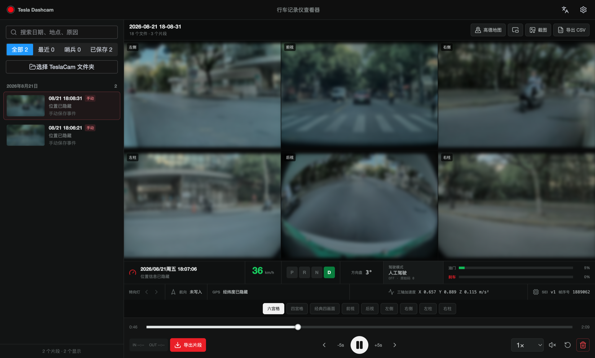
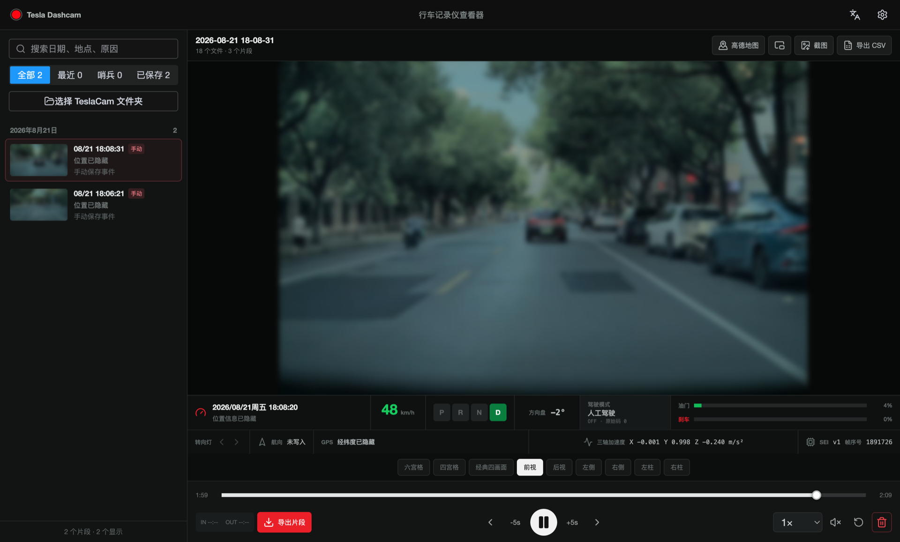
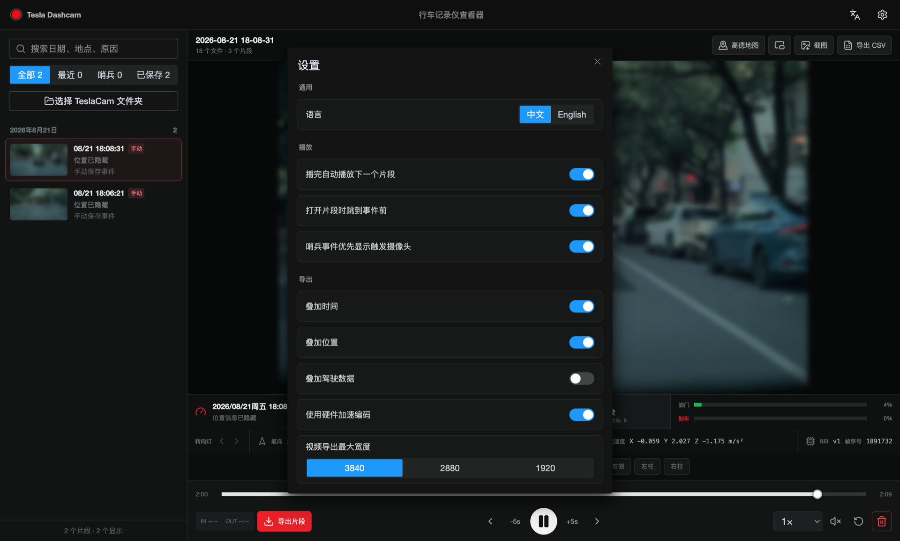

# Tesla Dashcam

Tesla 行车记录仪素材查看与导出工具。应用使用 Electron 和 Vue 3 构建，可在 macOS、Windows 和 Linux 上本地读取 TeslaCam 素材，同步播放最多六路摄像头，并解析视频中的 SEI 驾驶数据。

> 所有素材均在本机处理，不需要上传视频。下方截图中的地点、经纬度、GPS 轨迹及可识别画面细节均已隐藏。



## 主要功能

- 直接选择或拖入 `TeslaCam`、`RecentClips`、`SavedClips`、`SentryClips` 文件夹
- 按日期、录像类型、地点和事件原因筛选素材
- 自动读取 MP4 时长，将连续录像片段组装为完整时间线
- 同步播放前视、后视、左右侧及左右柱摄像头，支持最多六路画面
- 六宫格、四宫格、经典四画面和单摄像头视图自由切换
- 播放、暂停、前后跳转、倍速、静音、画中画和全屏查看
- 解析 SEI 驾驶数据，显示速度、档位、驾驶模式、油门、刹车、转向灯及 GPS 信息
- 显示速度曲线、事件位置、急刹标记和本地 GPS 行驶轨迹
- 导出当前画面、驾驶数据 CSV 和多摄像头合成 MP4
- 使用 IN/OUT 标记精确选择导出区间，显示导出进度并支持取消
- 确认后直接永久删除整个片段目录及附属文件，不经过系统废纸篓
- 中英文界面，支持自动连播、事件跳转、哨兵摄像头聚焦和导出设置

## 界面预览

<table>
  <tr>
    <td width="50%"><a href="docs/screenshots/driving-telemetry.png"></a></td>
    <td width="50%"><a href="docs/screenshots/export-settings.png"></a></td>
  </tr>
  <tr>
    <td align="center">单摄像头播放与驾驶数据仪表</td>
    <td align="center">中文界面与视频导出设置</td>
  </tr>
</table>

## 驾驶数据

驾驶数据来自 Tesla 视频内嵌的 SEI 元数据。应用不会根据画面猜测或生成不存在的数据；具体字段是否可用取决于车型、硬件版本、固件版本和录像文件本身。

| 数据 | 界面显示 | CSV | MP4 叠加 | 说明 |
| --- | :---: | :---: | :---: | --- |
| 速度 | ✓ | ✓ | ✓ | 以 `km/h` 显示 |
| 档位 | ✓ | ✓ | ✓ | `P / R / N / D / UNKNOWN` |
| 驾驶模式 | ✓ | ✓ | ✓ | `OFF / TACC / AP / FSD / UNKNOWN` |
| 油门 | ✓ | ✓ | ✓ | 百分比 |
| 刹车 | ✓ | ✓ | ✓ | 百分比 |
| 转向灯 | ✓ | ✓ | ✓ | 左 `<`、右 `>`、双闪 `<>` |
| 位置 | ✓ | ✓ | ✓ | 优先使用事件地点，其次使用 SEI 或事件经纬度 |
| 转向角、航向、三轴加速度 | ✓ | ✓ | - | 用于驾驶状态和事件分析 |

驾驶模式含义：

- `OFF`：人工驾驶，辅助驾驶未介入
- `TACC`：自适应巡航控制车速和跟车距离
- `AP`：Autopilot / Autosteer 辅助控制车速与方向
- `FSD`：FSD 驾驶功能已介入
- `UNKNOWN`：录像包含当前版本无法识别的状态值

## 视频导出

MP4 导出支持时间、位置和驾驶数据叠加。叠加信息使用独立的底部信息栏，不会覆盖摄像头画面；关闭全部叠加选项后不会保留空白黑边。

导出宽度提供 `3840`、`2880` 和 `1920` 三档，它们表示**最大输出宽度**：

- 原始或合成画面超过所选宽度时，按比例缩小
- 原始画面低于所选宽度时保持原尺寸，不强制放大
- 低分辨率视频无法通过导出获得真实的 4K 细节

应用使用 `ffmpeg-static` 完成视频合成，优先探测当前平台可用的 H.264 硬件编码器，失败时自动回退到 `libx264`。中文叠加统一使用随安装包携带的 Noto Sans CJK SC 字体，不依赖操作系统是否安装中文字体。

## 素材目录

支持 Tesla 标准目录结构：

```text
TeslaCam/
  RecentClips/
    YYYY-MM-DD_HH-mm-ss-front.mp4
    ...
  SavedClips/
    YYYY-MM-DD_HH-mm-ss/
      YYYY-MM-DD_HH-mm-ss-front.mp4
      event.json
      thumb.png
  SentryClips/
    YYYY-MM-DD_HH-mm-ss/
      ...
```

支持的摄像头文件后缀：

- `front`
- `back`
- `left_repeater`
- `right_repeater`
- `left_pillar`
- `right_pillar`

视频文件扩展名必须为小写 `.mp4`。缺少某一路摄像头时，应用会保留时间线同步并将对应画面显示为空。

## 平台支持

| 平台 | 安装包格式 | 说明 |
| --- | --- | --- |
| macOS | DMG | 支持 Apple Silicon；按目标机器架构构建 |
| Windows | NSIS `exe` | 当前配置目标为 x64 |
| Linux | AppImage、DEB、RPM | 字体与 FFmpeg 随应用打包 |

建议在对应目标操作系统上执行正式打包，以确保 Electron、FFmpeg 和安装器均使用正确的平台二进制文件。

## 本地开发

建议使用 Node.js 22.18+ 或 24.11+。

```sh
npm install
npm run dev
```

开发服务器默认读取 `.env.development` 中的端口，也可以临时覆盖：

```sh
VITE_DEV_PORT=5173 npm run dev
```

## 检查与构建

```sh
npm test
npm run typecheck
npm run build
```

测试模式构建：

```sh
npm run build:test
```

安装包输出到 `release/${version}`。`electron-builder.json5` 已配置 macOS、Windows 和 Linux 的安装目标。

## 隐私与安全

- 视频解析、驾驶数据解析、截图、CSV 和 MP4 合成都在本机完成
- 应用不会自动上传视频、GPS 或事件信息
- 只有主动点击“高德地图”时才会在系统浏览器中打开外部地图链接
- 删除操作会先核对完整片段清单，显示删除范围、目录和不可恢复警告；确认后再次校验并永久删除整个目录（`RecentClips` 会删除整个目录），默认选中取消
- 渲染进程关闭 `nodeIntegration` 并启用 `contextIsolation`

## 技术栈

- Electron 41
- Vue 3、Pinia、Vue I18n
- TypeScript、Vite
- Element Plus、Lucide
- FFmpeg

## License

项目代码采用 [MIT License](LICENSE)。随应用分发的 Noto Sans CJK SC 字体采用 [SIL Open Font License 1.1](public/fonts/LICENSE.txt)。
